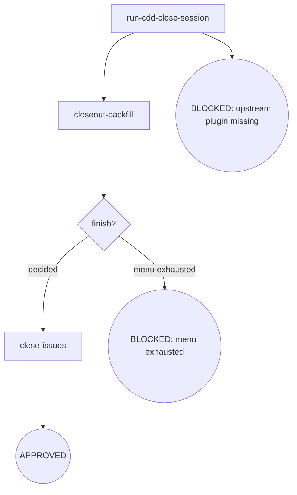

# Kairos CDD-Close

Development branch close-out: the closeout backfill — the shipped-state docs — lands and commits FIRST, in whichever of its two branches this branch carries (a registered phase row: the closeout version rows and the parent overall's Phase inventory → Done; a standalone single-spec with no phase row: only the spec's own version row and `## Change history`); then the imported upstream flow decides merge / PR / keep / discard, the finish gate routes the outcome, then related issues are closed — a human-decision surface, not next-driven, with no review self-loop. The backfill-before-finish ordering keeps the finish menu from running over an un-backfilled branch, so a merge decision ships the closeout with the branch.

**Invocation discipline** — every command runs as a background dispatch: launch it in the background and await the completion notification — never poll — then read the full output (stdout/stderr); output filtering is forbidden — no piping to `tail`/`head`, no `2>&1 |`, no `EXIT=$?` capture. **Dispatch boundary** — the obligation runs both ways: a dispatched child carries every verification / build command to completion inside its own turn, never ending that turn to await a background task it launched itself — ending the turn terminates the child, so the awaited notification never arrives and the round dies half-finished while still looking successful; the launching side certifies success by the terminal contract (a clean working tree and the target action actually completed), never by exit code 0. **Finish is the terminal gate** — the finish decision is a human-decision surface: it ends the flow at the gate + terminal (no review self-loop); a blocked round carries its reason on stderr with no `next:` line consumed here. **Failure face** — cross-node failure handling lives in the Failure Modes table below (the single source); node `Fail` entries keep only local behavior.

## Flow Digraph

## Node Definitions

### `run-cdd-close-session`

- **Do**: Import `/superpowers:finishing-a-development-branch`（pi：/skill:finishing-a-development-branch） and run its PRE-finish prerequisites (verify tests → read base). The finish menu itself runs at `finish?` — AFTER the closeout backfill has landed, so the closeout state is part of whatever the menu ships. **Upstream steps are not restated here.**
- **Read**: landed finish decision + base branch (`.kairos/cdd/<slug>/base.json`, or inferred per the cdd-dev base resolution)
- **Exit**: prerequisites passed → `closeout-backfill`
- **Fail**: tests red → BLOCKED (fix tests)

### `closeout-backfill`

- **Do**: Land the closeout before any finish decision — the shipped-state docs, one commit, with the branch shape picked explicitly from what the branch actually carries. **With a phase row** (the work completes a registered phase) ⇒ close the closeout version rows (plan / spec / overall version bumps · the parent-overall Phase inventory cells → Done · the acceptance delivery record · the change-history rows). **Without a phase row** (a standalone single-spec) ⇒ close only the spec's own version row plus its `## Change history` row, and touch no overall's Phase inventory. Either branch commits as its own conventional `docs(kairos)` commit and leaves the tree clean. The finish menu then ships the branch with the closeout in it; a failure at this node stops before the menu, never runs the finish over an uncommitted closeout
- **Read**: whichever branch applies — with a phase row: the phase's plan / spec / overall version rows + the parent-overall Phase inventory; without one: the standalone spec's own version row + its `issues:` line — plus `git status`
- **Exit**: closeout committed + tree clean → `finish?`
- **Fail**: dirty tree / write error → stop + report (do not enter the finish menu with an uncommitted closeout)

### `finish?`

- **Do**: Run the finish menu (merge / PR / keep / discard) and gate the landed outcome — the orchestration semantic gate, a human decision surface: the decision landed (merged / PR / kept / discarded) routes `close-issues`; an unrecognized outcome that exhausted the menu routes the BLOCKED terminal. The menu follows the closeout backfill. The strict typed-discard gate: the literal `discard` only (case-sensitive, no leading/trailing whitespace); any other input falls back to the menu without resetting its presentation counter — 3 attempts max → BLOCKED (menu exhausted). This gate is not next-driven — the human decision is the terminal authority, and the flow ends here: no review self-loop, no engine route to consume
- **Read**: the landed finish decision
- **Exit**: decided → `close-issues`; menu exhausted → the BLOCKED terminal (menu exhausted)
- **Fail**: no decision obtainable → BLOCKED (menu exhausted, flow terminates)

### `close-issues`

- **Do**: Close the issues that shipped with the finished work — for each `#NNN` in the finished work's scope, `gh issue close NNN` with the shipped state. The scope read follows the same two branches the closeout took: a registered phase reads the parent overall's item row for the phase, a standalone single-spec reads its own `issues:` line
- **Read**: the finished work's Issue inventory — a registered phase: the parent overall's item row for that phase + the spec's Issue inventory; a standalone single-spec: the spec's own `issues:` front-matter line — plus the finished branch
- **Exit**: Issues closed → the APPROVED terminal
- **Fail**: `gh` unavailable → report + fail-open (do not block the finish)

## Invariants

| # | Invariant |
|---|---|
| I1 | **No Worktrees** — skip the upstream worktree detection block and its cleanup; the menu is fixed to the normal-repo variant; worktree state is a pre-development violation (not cdd-close's scope) |
| I2 | **Conventional Commits + No Attribution** — merge commit / PR title follows conventional commits; no trailers / footers / inline attribution; PR body uses only `## Summary` + `## Test Plan` |
| I3 | **Finish is the terminal gate** — the finish decision is a human-decision surface: it ends the flow at the gate + terminal (no review self-loop); a blocked round carries its reason on stderr, with no `next:` line consumed here |
| I4 | **Closeout before finish** — the closeout backfill lands before the finish menu runs, in full for whichever branch shape the work carries: with a phase row, the closeout version rows + Phase inventory → Done; without one (a standalone single-spec), only the spec's own version row + change-history row and no Phase inventory touched. Committed, tree clean, before the menu — the finish decision never ships an un-backfilled branch |

## Failure Modes

| failure | behavior | reason |
|---|---|---|
| Upstream superpowers plugin missing | BLOCKED (install superpowers — see the kairos README's installation table) | Block policy: no silent fallback |
| Tests red before merge | BLOCKED (fix tests) | Do not merge/PR a red branch |
| Menu unrecognized input reaches the 3-attempt limit | BLOCKED (menu exhausted) | Cannot obtain user decision |
| Merge conflict / push rejected / PR failure | implicit fail-open (stop + report; branch and base retained; user recovers then re-runs cdd-close) | Do not auto-resolve |
| Closeout backfill fails (dirty tree / write error) | stop + report + fail-open | Do not enter the finish menu with an uncommitted closeout |
