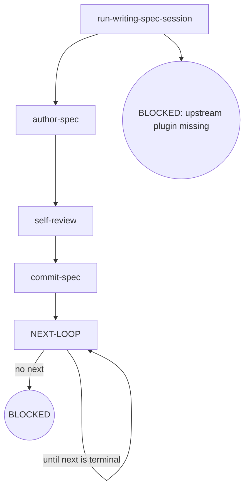

# Kairos CDD-Spec-Writer

Writes the target spec from the writing-spec import — single-spec / phase-spec / overall-spec under one parameterized flow (the schema target + scope gates + authoring differ by variant; the review-fix rhythm and the Invariants are the single shared skeleton) — commits it before reviewing under the cdd spec contract; on closure the engine's `next:` face carries the pipeline continuation.

**Invocation discipline** — every engine command runs as a background dispatch: launch it in the background and await the completion notification — never poll — then read the full output (stdout/stderr). Output filtering is forbidden — no piping to `tail`/`head`, no `2>&1 |`, no `EXIT=$?` capture. **Round rhythm** — one review pass per dispatch; a fix round re-enters the review while the route is not done; commit the authored spec before the first review round; ensure the working tree is clean before entering review (dirty → BLOCKED; the orchestrator writes no tree during dispatch). **Failure face** — cross-node failure handling lives in the Failure Modes table below (the single source); node `Fail` entries keep only local behavior.

## Flow Digraph

## Node Definitions

### `run-writing-spec-session`

- **Do**: Import `/superpowers:brainstorming`（pi：/skill:brainstorming） (writing-spec import); it lands the design decisions this target spec will capture. The target (single-spec / phase-spec / overall-spec) is the session parameter: it selects the schema target, the scope gates and the handoff of the flow
- **Read**: nothing before the import; the import lands the design + the target
- **Exit**: Import landed → `author-spec`
- **Fail**: Upstream superpowers plugin missing → BLOCKED (no downgrade, no skip, no inline restatement)

### `author-spec`

- **Do**: Write the target spec document to `docs/kairos/specs/` from the session output — generate the canonical skeleton first for the target type (`npx -y @oscaner-skills/cdd-engine@latest schema get <overall-spec|phase-spec|single-spec> --output skeleton <target path>`) and fill its slots in place; the structure stays as generated. Per the target variant:
  - **single-spec** — the free-form spec form; the docs-lane doc-contract gate asserts the version-lineage on every reviewed spec
  - **phase-spec** — the phase scope is an increment only: when the phase scope changed vs the parent overall, sync the parent overall (Issue/Phase inventory + Dependency graph + version bump + change history) BEFORE writing (the four-table sync ordering; the sync is the registration gate, never a silent skip)
  - **overall-spec** — the phase registration for a new phase is the parent's own table sync (see run-cdd-design's `run-cdd-charter · sync`)
- **Read**: Session output + the target's structural contract (phase-spec/overall-spec variants also read the parent overall)
- **Exit**: File written → `self-review`
- **Fail**: Session output unusable or write error → BLOCKED (missing design input)

### `self-review`

- **Do**: Review the just-written spec before committing — check spec coverage (every design decision the session landed is captured) + type consistency (doc-type / naming / cross-references agree) + zero leftover `:::fill` markers + zero angle-bracket literals outside link-anchor slots. Issues found are fixed inline on the same file; this is a pre-commit self-check inside this flow, not a review round (no `next:` dispatch, no findings carrier).
- **Read**: the written spec document + the session output it was authored from
- **Exit**: Self-check clean (issues fixed inline) → `commit-spec`
- **Fail**: Unresolvable defect needing upstream design input → BLOCKED (missing design input)

### `commit-spec`

- **Do**: `git add` the spec + conventional commit.
- **Read**: The committed spec file path
- **Exit**: Commit complete → `NEXT-LOOP`
- **Fail**: Git error → report + fail-open (do not block user spec review)

### `NEXT-LOOP`

- **Do**: Run the review-fix rhythm for the authored spec — one review per pass. Dispatch the review round on the current ref (`npx -y @oscaner-skills/cdd-engine@latest review --type spec --spec <path>`); dispatch the output's `next:` line as written — the literal is the route: a fix dispatch consumes the findings handoff, a closure ends the flow (follow the engine's `next:` literal — for a phase/overall spec it routes the next pipeline entrypoint); a BLOCKED/TIMEOUT round carries no `next:` line — its reason rides stderr for reporting.
- **Read**: the review output — its conclusion and the `next:` line, plus the findings handoff path
- **Exit**: the `next:` line routes the next pipeline entrypoint (a skill ref / the pipeline terminus) → the flow ends (the engine's `next:` literal carries the next pipeline entrypoint when one exists); each fix pass re-enters this hub while the route is not terminal — the engine's `next:` literal has not yet handed the orchestrator off (the `until next is terminal` self-loop)
- **Fail**: Re-running a review after a closure conclusion → violates Review Convergence (stop + report)

## Invariants

| # | Invariant |
|---|---|
| I1 | **Review Convergence (next: is the dispatch)** — a review closes by its conclusion (APPROVED / CHANGES_REQUESTED / REVIEW_FIX), and the output's `next:` line carries the engine's default next step as a complete executable command; read the `next:` line and dispatch it as written — the literal is the dispatch, no kind→command mapping layer. A mid-backfill or a user adjudication that lands governs over the suggestion (current world state wins). Fixes always dispatch via the fix round, consuming the findings handoff; the orchestrator must not edit in place as a substitute; a fix commit opens a new review, never a re-run of a closed one |
| I2 | **Spec commit discipline** — the authored spec commits before the first review round; each fix round commits its own changes — approval closes the loop on a committed state; do not wait for dev merge |
| I3 | **Mid-Flight Backfill** — a user-raised backfill of overall/spec/plan docs surfaced while a dispatch is in flight lands through four ordered steps on the current call's return: (1) **land immediately** — hot context, no deferral; (2) **commit on its own** — a standalone change, never mixed with implementation commits; (3) **pause the loop until clean** — an uncommitted backfill trips the next review's entry gate (dirty → BLOCKED); (4) **audit in-band on resume** — the next review audits the backfill in-band; a backfill rewriting the current task's own plan/spec text routes through the orchestrator as Plan Sole Writer |

## Failure Modes

| failure | behavior | reason |
|---|---|---|
| Upstream superpowers plugin missing | BLOCKED (install superpowers — see the kairos README's 'Upstream dependency install' table) | Block policy: no silent fallback |
| review re-run after a closure conclusion (REVIEW_FIX / APPROVED) | Violates I1 (Review Convergence) — stop + report to user | A fix commit opens a new review, never a re-run of a closed one |
| Git commit error | report + fail-open | Do not block user spec review |
| Completed round with no `next:` line (not BLOCKED/TIMEOUT) | HARD_ERROR — report the carried reason, re-run the same command to continue | No dispatchable next |
